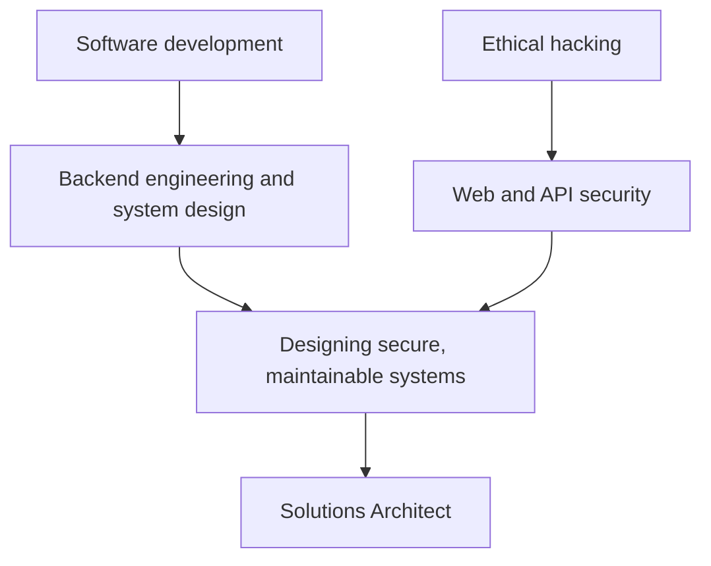

# 👋 Hey, I’m Tokelo

I’m a **final-year Computer Science student, full-stack developer, and co-founder of WebLocal** based in Johannesburg, South Africa. My favourite part of building software is turning an idea into something people can actually use. I like taking a rough sketch through to a working application, then seeing what I learn when someone else tries it.

Curiosity got me into computers. It’s also what makes me open the network tab when a page works perfectly. I want to know what happened between the click and the response.

## 🔭 What I’ve Done

I’ve built web and Android applications, developed backend APIs, and worked with authentication, databases, automated tests, and payment integrations. Through WebLocal, I’ve also taken care of what happens after a client’s site goes live. I manage deployments, DNS, and hosting, and I’ve built a Telegram bot in Python to help me monitor servers.

On the security side, I’ve built practice labs, explored bug bounties, and analysed traffic captured by a honeypot. That experience shapes how I write software. When I build an API endpoint, one of my first questions is who should be allowed to call it.

## 🧪 What I’m Exploring

I use Claude Code in my development workflow and spend some of my own time experimenting with open-weight language models.

## 🤖 LLMs I Use & Experiment With

  
  &nbsp;
  

- **Claude** — I use it through Claude Code to work through implementation ideas and review code as I build.
- **Qwen 27B** — I like giving it coding problems and running its answers. I also play with uncensored variants to see how different models handle the same prompt.

## 🎯 What I’m Working Toward

**As a developer**, I want to go deeper into backend engineering and system design. I want to build APIs other developers enjoy using and understand how a system behaves when traffic grows, a dependency fails, or someone needs to change code I wrote six months ago.

**As an ethical hacker**, I want to specialise in web application and API security. One milestone I’m working towards is earning my first bug bounty. I want to find a meaningful vulnerability in an authorised programme, explain its impact clearly, and give the developer enough detail to fix it.

**My long-term goal is to become a Solutions Architect.** Building software teaches me what it takes to deliver and run a system. Studying security teaches me where its assumptions can break. I want to bring both perspectives into the room when the design decisions are made, understand what people need, and help a team turn that idea into a system they can build, secure, and maintain.

## 🧰 Languages & Tools

### 🚀 Programming Languages

  
  
  
  
  
  

Java · C# · JavaScript · TypeScript · Kotlin · Python · SQL

### 🏗 Frameworks & Technologies

  
  
  
  
  

ASP.NET Core · Spring Boot · React · Next.js · Android · WPF

### ☁️ Databases & Cloud

  
  
  
  
  

Firebase · Firestore · Azure Blob Storage · PostgreSQL · SQL Server · SQLite

### 🛠 Tools & Platforms

  
  
  
  
  

Git · Docker · VS Code · Visual Studio · GitHub Actions · Coolify · Claude Code

### 🐧 Operating Systems & Cybersecurity

  
  
  

Kali Linux · Linux · Windows · Burp Suite · Wireshark · OWASP ZAP

### 🌐 Browsers & Testing

  
  
  
  

Chrome · Firefox · Postman · JUnit

## 🤝 Open to Collaborating

I’m interested in open-source developer tools, full-stack applications, and defensive security projects. I enjoy working with people who like digging into how things work and sharing what they learn.

## 📫 Find Me

- [Personal GitHub · John12-Tuks](https://github.com/John12-Tuks)
- [School GitHub · KgomoTokelo](https://github.com/KgomoTokelo)
- [Email · tokelokgopotso@gmail.com](mailto:tokelokgopotso@gmail.com)

## ⚡ Fun Fact

I can switch from coding to bodybuilding mode faster than my VM boots.

<!--
John12-Tuks/John12-Tuks is a special repository because it is my public GitHub profile README.
-->
